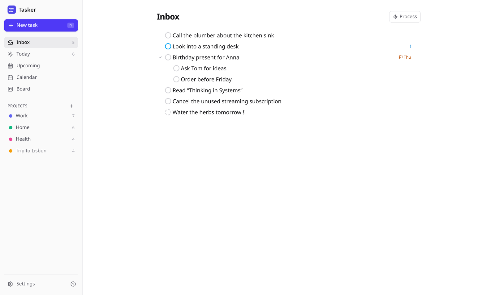
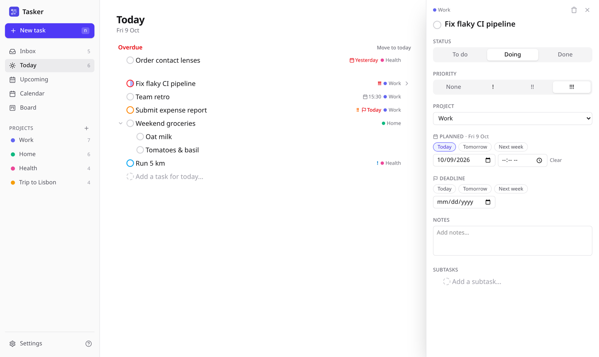
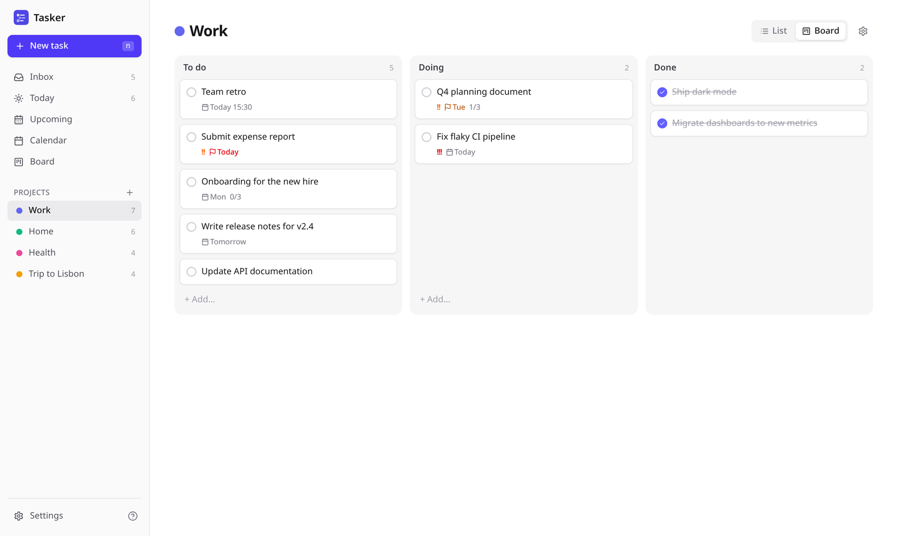
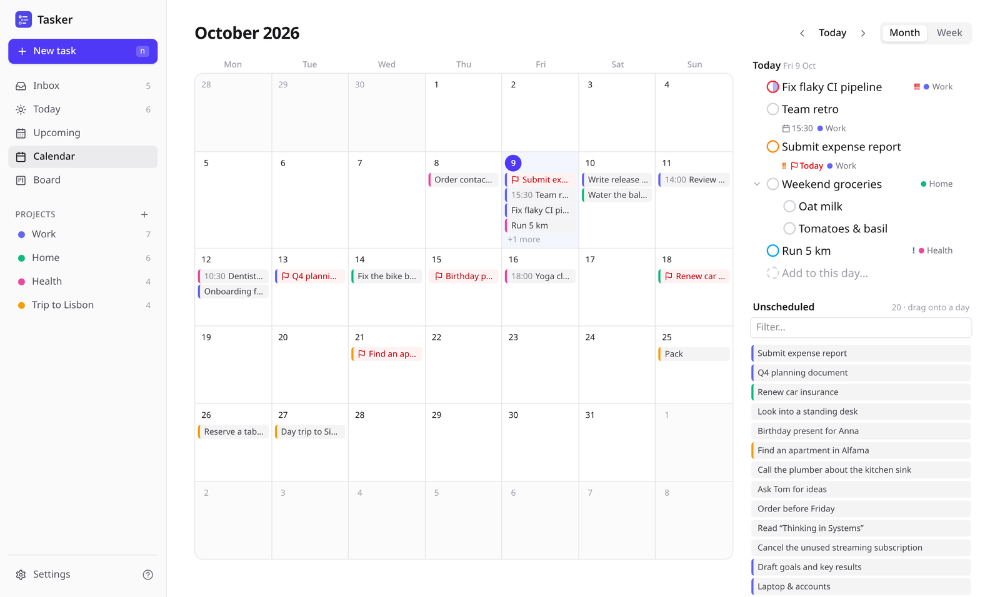
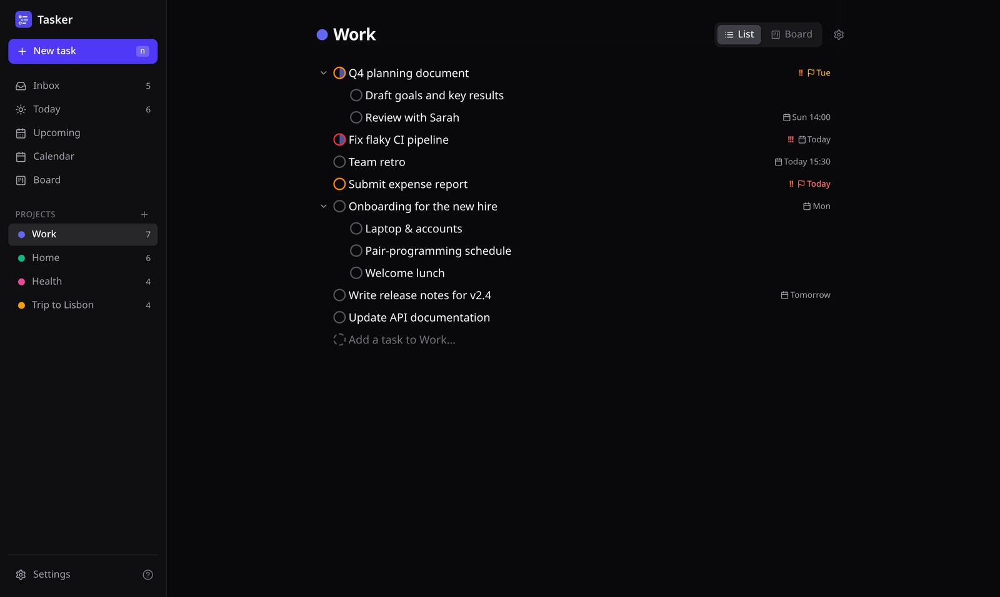
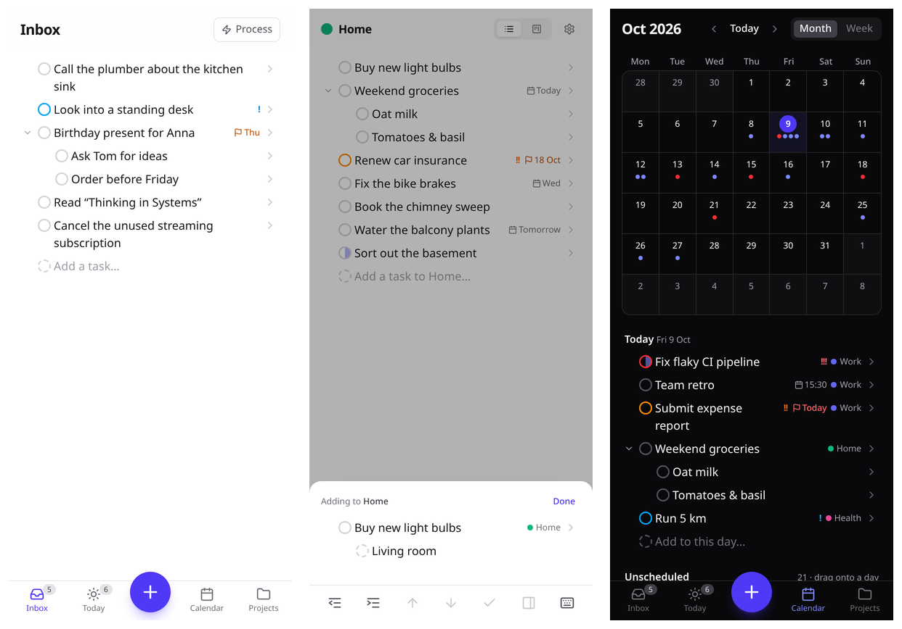

# Tasker

A personal, capture-first task manager for desktop and mobile. It includes a calendar with a subscribable ICS feed, Kanban boards, projects, priorities and deadlines. The design rule throughout: **adding a task must feel like typing a bullet list.**



<table>
  <tr>
    <td width="50%"><br><sub><b>Today</b>: overdue items, a mixed list across projects, and every setting in the details panel</sub></td>
    <td width="50%"><br><sub><b>Kanban</b>: drag cards between To do, Doing and Done</sub></td>
  </tr>
  <tr>
    <td width="50%"><br><sub><b>Calendar</b>: drag unscheduled tasks onto a day; deadlines are flagged</sub></td>
    <td width="50%"><br><sub><b>Projects</b>: nested outlines, in light and dark mode</sub></td>
  </tr>
</table>

<p align="center"></p>

## How the features stay out of the way

| Idea                          | What it means                                                                                                                                                                                                         |
| ----------------------------- | --------------------------------------------------------------------------------------------------------------------------------------------------------------------------------------------------------------------- |
| Capture is an outliner        | `Enter` starts the next line. `Tab` / `Shift+Tab` indent and outdent to make subtasks. Pasting a bulleted or indented list creates the whole tree. There are no forms.                                                |
| The page fills in the details | A task typed on a project page lands in that project. On _Today_ it is planned for today, on a calendar day for that day, and in a Kanban column it gets that status. Subtasks follow their parent's project.         |
| Optional inline shortcuts     | Shortcuts such as `fri`, `!!`, `#project` and `due 17.10` are applied **only when you press Enter**. They are removed from the title and confirmed in a message with **Undo**. Text that doesn't parse stays as text. |
| Settings live elsewhere       | Every option sits in the details panel (`Shift+Enter`, or the › on a line). It is a side panel on desktop and a bottom sheet on mobile.                                                                               |
| Sort later, if ever           | The Inbox has an optional **Process** mode that steps through tasks one at a time with single keys (`p` project, `t`/`m`/`w` date, `1–3` priority, `Enter` next).                                                     |
| Capture from anywhere         | Press `n` on desktop or the **+** on mobile. Tasks are filed into the page you're on. On a phone, text shared to Tasker from other apps lands in the Inbox.                                                           |

### Typing shortcuts

These work in English and German.

| Type                                                                                    | Result                                       |
| --------------------------------------------------------------------------------------- | -------------------------------------------- |
| `tomorrow`, `fri`, `next week`, `17.10`, `17 oct`, `in 3 days` _(at the end of a line)_ | Planned date                                 |
| `at 10`, `14:00`, `9am`, `um 14 uhr`                                                    | Time; the planned date defaults to today     |
| `due fri`, `by 17.10`, `bis freitag`, `^fri`, `due:17.10`                               | Deadline                                     |
| `!`, `!!`, `!!!` (or `p3`, `p2`, `p1`)                                                  | Priority low / medium / high                 |
| `#health`                                                                               | Existing project (a unique prefix is enough) |
| `@fri`, `@14:00`                                                                        | Date or time anywhere in the line            |

Press `?` in the app for all keyboard shortcuts.

## Running it

### Development

```sh
npm install
cp .env.example .env        # DATABASE_URL=data/tasker.db, TASKER_PASSWORD empty = no login
npm run dev
```

To try it with sample data, run `node scripts/seed-demo.mjs http://localhost:5173` against a running instance with login disabled. To regenerate the README screenshots, run `node scripts/screenshots.mjs <url>` against a seeded instance.

The database file and its migrations are created automatically on start. After changing `src/lib/server/db/schema.ts`, run `npm run db:generate` to add a migration.

### Docker (self-hosted)

```sh
echo "TASKER_PASSWORD=choose-something-long" > .env
docker compose up -d --build
```

- Data is stored in the `tasker-data` volume at `/data/tasker.db`.
- The container listens on `127.0.0.1:3000` only. Put nginx in front of it with TLS: HTTPS is required for installing the PWA, for the service worker and for secure cookies.

#### nginx

[deploy/nginx/tasker.conf](deploy/nginx/tasker.conf) is a ready-to-use site config. It provides:

- HTTP→HTTPS redirect, with ACME challenges for certbot
- HTTP/2 and HSTS
- rate limiting on `/login`
- a no-cache rule for the service worker
- no access logging for the calendar feed, whose URL contains the secret token

```sh
sudo cp deploy/nginx/tasker.conf /etc/nginx/conf.d/tasker.conf
sudo sed -i 's/tasks.example.com/your.domain/g' /etc/nginx/conf.d/tasker.conf
sudo mkdir -p /var/www/certbot
# First certificate: comment out the 443 server block, reload nginx, then:
sudo certbot certonly --webroot -w /var/www/certbot -d your.domain
sudo nginx -t && sudo systemctl reload nginx
```

nginx must forward `X-Forwarded-Proto` and `X-Forwarded-Host`, as the config does. Without them, SvelteKit rejects the login form as a cross-site request.

| Variable                         | Purpose                                                                  |
| -------------------------------- | ------------------------------------------------------------------------ |
| `DATABASE_URL`                   | SQLite file path (default `/data/tasker.db` in the container)            |
| `TASKER_PASSWORD`                | Login password for the single user. Changing it signs out every session. |
| `PROTOCOL_HEADER`, `HOST_HEADER` | adapter-node settings for running behind a proxy                         |

### Calendar feed

_Settings → Calendar feed_ has a subscription link for all tasks and one per project.

- Planned tasks appear as all-day events.
- Planned tasks with a time appear as 30-minute blocks, in the subscriber's local time.
- Deadlines appear as `⚑` all-day events.
- Completed tasks are left out.

Anyone with a link can read the feed. **Reset links** revokes all of them.

### Phone

Open the site and choose **Add to Home Screen**. The app keeps working briefly offline: changes are queued on the device and synced when the connection returns.

## Architecture

- **SvelteKit 3** (Svelte 5 runes) with `adapter-node`, **Tailwind 4**, and **SQLite** through Drizzle and better-sqlite3.
- `src/lib/client/store.svelte.ts` is the client-side source of truth. Every change is applied locally first, then queued as an op (`task.upsert`, `task.update`, …) and flushed to `POST /api/ops`. The queue is coalesced and kept in `localStorage`, so offline edits survive a reload.
- `src/lib/components/Outliner.svelte` is the single capture component. Inbox, Today, Upcoming, projects, calendar days, the details panel and quick capture all use it, each with its own `filter` and `defaults`.
- Pure, unit-tested logic:
  - `src/lib/tokens.ts`: the inline shortcut parser
  - `src/lib/paste.ts`: list to tree
  - `src/lib/ics.ts`: the RFC 5545 writer
- Ordering uses fractional index keys:
  - `sortKey` orders siblings in lists.
  - `boardKey` orders cards within a Kanban column.

## Tests

```sh
npm run test:unit -- --run   # parser, paste, ICS
npm run test:e2e             # Playwright: capture, paste, tokens, Kanban + calendar drag, ICS feed
```
